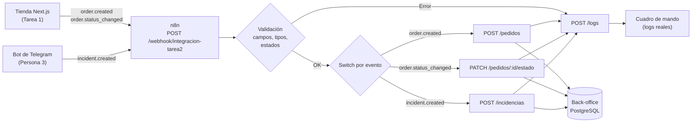

# Contrato de integración tienda → n8n → back-office

**Versión:** 1.0  
**Fecha:** 3 de noviembre de 2026  
**Responsable:** Persona 2 (workflow n8n, contrato y errores)  
**Ámbito:** Tarea 2 — integración de la tienda (Tarea 1) con el back-office independiente.

Este documento es el acuerdo entre la tienda, el workflow de n8n y el
back-office. Cualquier cambio en un campo, un estado o un código de respuesta
tiene que actualizar este fichero y el workflow exportado.

## 1. Arquitectura



La tienda **no habla directamente con el back-office en producción**. Su única
salida es `INTEGRACION_WEBHOOK_URL`, que apunta al webhook de n8n. n8n valida,
transforma, enruta y registra. El back-office es el único que escribe en su
base de datos.

En local se puede apuntar `INTEGRACION_WEBHOOK_URL` directamente al back-office
(`http://localhost:4000/pedidos`) para probar sin n8n. En ese caso el
back-office aplica sus propias validaciones e idempotencia, pero **no hay
registro de la ejecución de n8n** ni `duracion_ms`.

## 2. Transporte

| Aspecto                      | Decisión                                                                                                          |
| ---------------------------- | ----------------------------------------------------------------------------------------------------------------- |
| Protocolo                    | HTTPS en producción, HTTP en local                                                                                |
| Formato                      | JSON UTF-8                                                                                                        |
| Cabecera                     | `Content-Type: application/json`                                                                                  |
| Método                       | `POST` al webhook de n8n; n8n usa `POST`/`PATCH` contra el back-office                                            |
| Autenticación                | **No implementada** en el prototipo. El back-office no valida token. Riesgo aceptado y documentado en la memoria. |
| Timeout tienda → n8n         | 5 s (`AbortSignal.timeout(5000)` en `lib/integracion/enviar-integracion.ts`)                                      |
| Timeout n8n → back-office    | 10 s por intento                                                                                                  |
| Reintentos n8n → back-office | 3 intentos, 2 s entre intentos                                                                                    |
| Reintentos tienda → n8n      | Ninguno. Si falla, la tienda ya ha cobrado y el error queda en consola; el pedido se puede reenviar a mano.       |

> **Render Free:** tanto n8n como el back-office se duermen tras 15 minutos sin
> tráfico. Un arranque en frío puede superar el timeout de 5 s de la tienda.
> Para la demo hay que mantenerlos despiertos con el workflow de keep-alive
> (`.github/workflows/keepalive.yml`) o con un cron externo.

## 3. Sobre común

Todos los eventos comparten un campo `evento` que identifica el tipo de caso.
El workflow rechaza cualquier valor que no esté en la lista.

| Campo    | Tipo   | Obligatorio | Descripción                                                  |
| -------- | ------ | ----------- | ------------------------------------------------------------ |
| `evento` | string | Sí          | `order.created`, `order.status_changed` o `incident.created` |

## 4. Evento `order.created`

Lo emite la tienda cuando el pedido ya existe en Supabase (webhook de Stripe o
página de confirmación). Es el **Escenario 1**.

### 4.1 Campos

| Campo               | Tipo    | Obligatorio | Regla                                                                                   |
| ------------------- | ------- | ----------- | --------------------------------------------------------------------------------------- |
| `pedido_id`         | string  | Sí          | Clave de idempotencia. Si se repite, no se duplica.                                     |
| `cliente_email`     | string  | No          | Si viene, debe tener formato de email. Puede ser `null`.                                |
| `cliente_nombre`    | string  | No          | Texto libre.                                                                            |
| `total`             | number  | Sí          | Mayor que 0.                                                                            |
| `moneda`            | string  | No          | ISO 4217 de 3 letras. Por defecto `EUR`.                                                |
| `estado`            | string  | No          | `creado`, `pago_simulado`, `preparacion`, `enviado`, `cancelado`. Por defecto `creado`. |
| `fecha`             | string  | No          | ISO 8601. Por defecto, la fecha de recepción en n8n.                                    |
| `lineas`            | array   | Sí          | Al menos una línea.                                                                     |
| `lineas[].producto` | string  | Sí          | Nombre del producto.                                                                    |
| `lineas[].cantidad` | integer | Sí          | Entero mayor que 0.                                                                     |
| `lineas[].precio`   | number  | Sí          | Mayor o igual que 0. Precio unitario sin IVA.                                           |

### 4.2 Ejemplo

```json
{
  "evento": "order.created",
  "pedido_id": "ORD-001",
  "cliente_email": "ana@test.com",
  "cliente_nombre": "Ana García",
  "total": 258.0,
  "moneda": "EUR",
  "estado": "creado",
  "fecha": "2026-10-29T10:00:00Z",
  "lineas": [{ "producto": "Camiseta Eren", "cantidad": 2, "precio": 129.0 }]
}
```

### 4.3 Destino

`POST /pedidos` con el payload normalizado. El back-office responde:

| Caso                       | HTTP  | Cuerpo                                   |
| -------------------------- | ----- | ---------------------------------------- |
| Pedido nuevo               | `201` | `{ "ok": true, "pedido_id": "ORD-001" }` |
| Pedido repetido            | `200` | `{ "aviso": "El pedido ya existía" }`    |
| Validación del back-office | `422` | `{ "error": "..." }`                     |

## 5. Evento `order.status_changed`

Lo emite la tienda cuando un administrador cambia el estado de un pedido en
`/admin/pedidos`. Es el **Escenario 2** (sincronización de estado).

### 5.1 Campos

| Campo             | Tipo   | Obligatorio | Regla                                                             |
| ----------------- | ------ | ----------- | ----------------------------------------------------------------- |
| `pedido_id`       | string | Sí          | Pedido que ya existe en el back-office.                           |
| `estado_anterior` | string | No          | Mismo enum que `estado`. Solo informativo.                        |
| `estado`          | string | Sí          | `creado`, `pago_simulado`, `preparacion`, `enviado`, `cancelado`. |

### 5.2 Ejemplo

```json
{
  "evento": "order.status_changed",
  "pedido_id": "ORD-001",
  "estado_anterior": "creado",
  "estado": "enviado"
}
```

### 5.3 Destino

`PATCH /pedidos/ORD-001/estado` con `{ "estado": "enviado" }`. El back-office
responde:

| Caso               | HTTP  | Cuerpo                                                        |
| ------------------ | ----- | ------------------------------------------------------------- |
| Estado aplicado    | `200` | `{ "ok": true, "pedido_id": "ORD-001", "estado": "enviado" }` |
| Pedido inexistente | `404` | `{ "error": "Pedido no encontrado" }`                         |
| Estado inválido    | `422` | `{ "error": "Estado inválido. Valores: ..." }`                |

> El back-office también acepta `order.status_changed` por `POST /pedidos` como
> _fallback_ para el modo directo sin n8n. El workflow **no usa ese atajo**:
> llama a `PATCH`, que es la ruta explícita del contrato.

## 6. Evento `incident.created`

Lo envía el flujo de Telegram de la Persona 3 al mismo webhook. Es el
**Escenario 3** (incidencia postventa).

### 6.1 Campos

| Campo              | Tipo   | Obligatorio | Regla                                                                   |
| ------------------ | ------ | ----------- | ----------------------------------------------------------------------- |
| `incidencia_id`    | string | Sí          | Clave de idempotencia.                                                  |
| `pedido_id`        | string | No          | Pedido asociado. Puede no existir todavía.                              |
| `cliente_email`    | string | No          | Si viene, email válido.                                                 |
| `telegram_chat_id` | string | No          | Chat de origen.                                                         |
| `tipo`             | string | Sí          | Texto libre (por ejemplo `retraso_envio`).                              |
| `descripcion`      | string | Sí          | Texto libre.                                                            |
| `estado`           | string | No          | `abierta`, `en_revision`, `resuelta`, `cerrada`. Por defecto `abierta`. |
| `prioridad`        | string | No          | `alta`, `media`, `baja`. Puede ser `null`.                              |
| `fecha`            | string | Sí          | ISO 8601.                                                               |

### 6.2 Ejemplo

```json
{
  "evento": "incident.created",
  "incidencia_id": "INC-001",
  "pedido_id": "ORD-001",
  "cliente_email": "ana@test.com",
  "telegram_chat_id": "123456789",
  "tipo": "retraso_envio",
  "descripcion": "Mi pedido no ha llegado",
  "estado": "abierta",
  "prioridad": "alta",
  "fecha": "2026-10-30T10:00:00Z"
}
```

### 6.3 Destino

`POST /incidencias`. El back-office responde `201` si es nueva, `200` si ya
existía y `422` si falta un campo o un enum no cuadra. La incidencia puede
crearse aunque el pedido no exista; en ese caso el back-office añade el aviso
`pedido no encontrado` en el detalle del log.

## 7. Respuestas del webhook de n8n

La tienda solo mira `respuesta.ok`; no interpreta el cuerpo. Aun así, el
contrato fija el cuerpo para que las evidencias y las pruebas sean claras.

| Situación                           | HTTP  | Cuerpo                                                                                         |
| ----------------------------------- | ----- | ---------------------------------------------------------------------------------------------- |
| Pedido creado                       | `201` | `{ "ok": true, "pedido_id": "...", "execution_id": "..." }`                                    |
| Pedido duplicado                    | `200` | `{ "ok": true, "duplicado": true, "pedido_id": "...", "execution_id": "..." }`                 |
| Estado aplicado                     | `200` | `{ "ok": true, "pedido_id": "...", "estado": "...", "execution_id": "..." }`                   |
| Incidencia creada                   | `201` | `{ "ok": true, "incidencia_id": "...", "execution_id": "..." }`                                |
| Incidencia duplicada                | `200` | `{ "ok": true, "duplicado": true, "incidencia_id": "...", "execution_id": "..." }`             |
| Validación fallida                  | `422` | `{ "ok": false, "evento": "...", "errores": ["..."], "execution_id": "..." }`                  |
| Back-office no encuentra la entidad | `404` | `{ "ok": false, "codigo_error": "BACKOFFICE_404", "pedido_id": "...", "execution_id": "..." }` |
| Back-office responde 422            | `422` | `{ "ok": false, "codigo_error": "BACKOFFICE_422", "execution_id": "..." }`                     |
| Back-office caído o error interno   | `502` | `{ "ok": false, "codigo_error": "BACKOFFICE_5XX", "execution_id": "..." }`                     |
| Timeout del back-office             | `504` | `{ "ok": false, "codigo_error": "BACKOFFICE_TIMEOUT", "execution_id": "..." }`                 |

## 8. Códigos de error

| Código               | HTTP  | Significado                                                                                          | Dónde se genera        |
| -------------------- | ----- | ---------------------------------------------------------------------------------------------------- | ---------------------- |
| `VALIDACION`         | `422` | Falta un campo, un tipo no cuadra, email inválido, importe ≤ 0, línea vacía o estado fuera del enum. | Nodo `Validar payload` |
| `BACKOFFICE_404`     | `404` | El pedido o la incidencia no existe en el back-office.                                               | Nodo `Error *`         |
| `BACKOFFICE_422`     | `422` | El back-office rechaza un payload que n8n dejó pasar (defensa en profundidad).                       | Nodo `Error *`         |
| `BACKOFFICE_5XX`     | `502` | Error 5xx, red caída o respuesta inesperada.                                                         | Nodo `Error *`         |
| `BACKOFFICE_TIMEOUT` | `504` | Sin respuesta en 10 s tras los reintentos.                                                           | Nodo `Error *`         |

## 9. Idempotencia

Hay **dos capas** y las dos son necesarias:

1. **Back-office (capa fuerte):** `pedido_id`, `incidencia_id` y
   `decision_id` son claves primarias. El `INSERT ... ON CONFLICT DO NOTHING`
   garantiza que un reintento no duplica la entidad, aunque llegue a la vez por
   dos caminos.
2. **n8n (capa visible):** cuando el back-office responde `200` con `aviso`, el
   nodo `Evaluar *` marca `duplicado: true`, devuelve `200` a la tienda y
   registra `detalle: "duplicado ignorado"` en `POST /logs`.

No se usa una comprobación previa `GET /pedidos/:id` porque sería una carrera
entre el `GET` y el `POST`. La clave primaria del back-office es la que decide.

**Prueba:** enviar dos veces `n8n/payloads/01-pedido-valido.json`. La primera
respuesta es `201`; la segunda, `200` con `duplicado: true`. En `GET /pedidos`
solo hay una fila con `ORD-001`.

## 10. Registro de ejecuciones

Cada ejecución del workflow llama a `POST /logs` **tanto en la rama correcta
como en la de error**. El `execution_id` es el de n8n, así que un reintento del
mismo workflow no duplica la métrica.

```json
{
  "execution_id": "12345",
  "evento": "order.created",
  "pedido_id": "ORD-001",
  "resultado": "correcto",
  "codigo_error": null,
  "detalle": "pedido creado",
  "duracion_ms": 184,
  "origen": "n8n"
}
```

| Campo          | Tipo   | Obligatorio | Nota                                                                   |
| -------------- | ------ | ----------- | ---------------------------------------------------------------------- |
| `execution_id` | string | No          | Clave de idempotencia del log.                                         |
| `evento`       | string | Sí          | Evento del contrato.                                                   |
| `pedido_id`    | string | No          | Pedido asociado; en incidencias, el pedido de la incidencia si existe. |
| `resultado`    | string | Sí          | `correcto` o `error`.                                                  |
| `codigo_error` | string | No          | Uno de los códigos de la sección 8.                                    |
| `detalle`      | string | No          | Texto legible para la evidencia.                                       |
| `duracion_ms`  | number | No          | Tiempo total del workflow en ms.                                       |
| `origen`       | string | No          | `n8n` para las ejecuciones de este workflow.                           |

> El back-office también escribe sus propios logs internos (`origen: null`).
> Para métricas de integración hay que filtrar por `origen = "n8n"` o por la
> presencia de `execution_id`; así no se cuentan dos veces los mismos eventos.

### 10.1 Notificación de errores

Las cuatro ramas de error (validación, pedido, estado e incidencia) intentan
enviar un aviso a Telegram después de registrar el log:

- URL: `https://api.telegram.org/bot{TELEGRAM_BOT_TOKEN}/sendMessage`
- Chat: `ALERT_TELEGRAM_CHAT_ID`
- Texto: evento, código de error y detalle.

Es **opcional**. Si el token o el chat no están configurados, el nodo falla y
`onError: continueRegularOutput` deja seguir el flujo: el aviso no puede tumbar
la respuesta al webhook. El bot es el mismo de la Persona 3, así que no hace
falta crear otro.

### 10.2 Aviso de incidencia creada

Cuando una incidencia se crea correctamente (nueva o duplicada), el workflow
envía un mensaje a **Telegram** al chat configurado en
`ALERT_TELEGRAM_CHAT_ID` con:

- `incidencia_id`
- `pedido_id`
- `cliente_email`
- `tipo`
- `prioridad`
- `descripcion`
- si ya existía o es nueva

Es un aviso **interno para el equipo**, no un mensaje al cliente. El cliente de
la tienda no tiene `telegram_chat_id`, así que la incidencia web se guarda con el
chat de demo configurado en `INCIDENCIAS_TELEGRAM_CHAT_ID` (por defecto
`7683478497`) o con `null` si no se configura. Ese chat no es el del cliente: es
el del equipo/pruebas. Un cliente real de Telegram trae su propio
`telegram_chat_id` en el payload.

El aviso también se dispara para las incidencias que nacen en Telegram y pasan
por este workflow. Si la Persona 3 usa el mismo chat para la aprobación, ese
chat recibirá el aviso de incidencia y los botones de aprobación.

Si `TELEGRAM_BOT_TOKEN` o `ALERT_TELEGRAM_CHAT_ID` no están configurados, el
aviso falla pero la incidencia se crea igualmente: el nodo tiene
`onError: continueRegularOutput`.

## 11. Validaciones: dónde y por qué

| Validación                            | n8n                | Back-office   | Motivo                                                                                       |
| ------------------------------------- | ------------------ | ------------- | -------------------------------------------------------------------------------------------- |
| Campos obligatorios                   | Sí                 | Sí            | n8n falla rápido y devuelve un 422 uniforme; el back-office se protege de llamadas directas. |
| Tipos (`total`, `cantidad`, `precio`) | Sí                 | Sí            | Evita que un string llegue a PostgreSQL.                                                     |
| Email                                 | Sí                 | No            | La tienda ya lo valida; n8n lo comprueba por si el emisor cambia.                            |
| Estados y prioridades                 | Sí                 | Sí            | Listas cerradas en los dos lados.                                                            |
| Líneas no vacías                      | Sí                 | Sí            | Un pedido sin líneas no es factible.                                                         |
| Idempotencia                          | Detecta el `aviso` | `ON CONFLICT` | La base de datos decide; n8n lo hace visible.                                                |

## 12. Ficheros de prueba

Los fixtures están en `n8n/payloads/`:

| Fichero                       | Escenario           | Respuesta esperada        |
| ----------------------------- | ------------------- | ------------------------- |
| `01-pedido-valido.json`       | Escenario 1         | `201`                     |
| `02-pedido-duplicado.json`    | Idempotencia        | `200` + `duplicado: true` |
| `03-pedido-invalido.json`     | Error de validación | `422` + `VALIDACION`      |
| `04-estado-valido.json`       | Escenario 2         | `200`                     |
| `05-estado-invalido.json`     | Error de estado     | `422` + `VALIDACION`      |
| `06-incidencia-valida.json`   | Escenario 3         | `201`                     |
| `07-incidencia-invalida.json` | Error de incidencia | `422` + `VALIDACION`      |
| `08-evento-desconocido.json`  | Evento no soportado | `422` + `VALIDACION`      |

Los payloads canónicos de la entrega siguen estando en `backoffice/payloads/`.
Estos son los que usa el workflow de n8n en las pruebas de la Persona 2.

## 13. Cambios y compatibilidad

- Añadir un campo opcional no rompe el contrato.
- Añadir un estado nuevo exige tocar el enum de n8n **y** el del back-office.
- Cambiar el nombre de un campo obligatorio es una versión nueva del contrato.
- El workflow exportado (`n8n/workflow-integracion.json`) y este documento
  deben viajar juntos en el mismo commit.
- Los tests de `n8n/test/workflow.test.mjs` comprueban que el JSON importable
  sigue cumpliendo las reglas de validación y de estructura.

## 14. Riesgos conocidos

1. **Sin autenticación:** cualquiera con la URL del webhook puede enviar un
   evento. Mitigación propuesta: token compartido (`Authorization: Bearer`) o
   lista de IPs. No implementado para no bloquear la demo.
2. **Render Free se duerme:** el primer evento tras 15 minutos puede agotar el
   timeout de 5 s de la tienda. Mitigación: keep-alive cada 10 minutos.
3. **n8n sin disco persistente:** el workflow y las credenciales viven en
   Supabase; el `N8N_ENCRYPTION_KEY` tiene que ser fijo o las credenciales
   cifradas se pierden al reiniciar.
4. **Doble registro de logs:** el back-office registra la entidad y n8n registra
   la ejecución. Las métricas de integración deben filtrar por `origen`.
